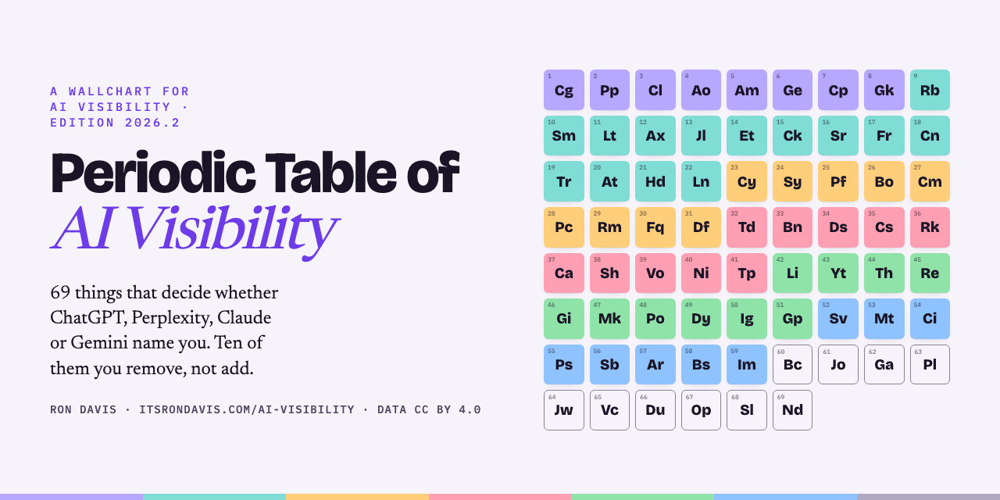

# Periodic Table of AI Visibility



**The 69 things that decide whether ChatGPT, Perplexity, Claude, Gemini, Copilot, Grok, Google AI Overviews or AI Mode name your company — and the 10 to remove before you add anything.**

By [Ron Davis](https://www.itsrondavis.com) · Edition 2026.2 · audited 2026-10-02 · Canonical page: **[itsrondavis.com/ai-visibility](https://www.itsrondavis.com/ai-visibility)** · Data: CC BY 4.0 · Skills: MIT

> **AI visibility** is whether an answer engine names your company when a buyer asks a category question. It covers four outcomes: **ranking** (your position in a list), **citation** (a linked source inside the answer), **mention** (named, no link) and **recognition** (the model knows you without looking anything up). Being listed is ranking. Being chosen is the other three.

This repository is the table as data, the table as a wallchart, and the table as eight installable AI skills you drop into Claude, ChatGPT, Gemini or Copilot. An element is one thing you can fix on its own. A blank square is an element you do not have yet. Find the blank squares and you can predict what an answer engine does with your site before you ever ask it.

[**Open the interactive wallchart →**](https://agents.itsrondavis.com/ai-visibility/) · [elements.json](data/elements.json) · [elements.csv](data/elements.csv) · [36 questions](data/questions.json) · [the skills](skills/) · [one-file pack](pack/ai-visibility-skill-pack.md)

---

## Contents

1. [How do I read the table?](#how-do-i-read-the-table)
2. [The 69 elements, by group](#the-69-elements-by-group)
3. [What should I fix this weekend?](#what-should-i-fix-this-weekend)
4. [36 questions people ask about AI visibility](#36-questions-people-ask-about-ai-visibility)
5. [SEO, AEO, GEO, LLMO: which word means what?](#seo-aeo-geo-llmo-which-word-means-what)
6. [The eight skills](#the-eight-skills)
7. [Install in your model](#install-in-your-model)
8. [Who made this, and from what](#who-made-this-and-from-what)
9. [The kit, the call, the newsletter](#the-kit-the-call-the-newsletter)
10. [How this README applies its own table](#how-this-readme-applies-its-own-table)
11. [Changelog and audit history](#changelog-and-audit-history)

---

## How do I read the table?

The Periodic Table of AI Visibility groups 69 elements into seven rows by what they do:

| Group | What it covers | Elements |
|---|---|---|
| **Engines** | the surfaces that do the citing | 8 |
| **Retrieval** | whether a machine can read you at all | 14 |
| **Signals** | what the model weighs once it can read you | 9 |
| **Artifacts** | the shapes that actually get quoted | 10 |
| **Channels** | where the artifact goes to be found | 10 |
| **Measurement** | how you know any of it moved | 8 |
| **Inhibitors** | subtract, don't add | 10 |

Every element carries a **time-to-effect tag**: **d** = days, **w** = weeks, **q** = quarters. It says how long after the fix you should expect the engines to notice. Sort any list of fixes by this tag and do the days first.

**Inhibitors are outlined, not filled.** They are the ten things to remove. Removing one inhibitor is faster than adding anything in the rows above it, so the audit always starts at the bottom row.

Each element has four parts: **what it is**, **the move** (the one thing to do), **the watch-out** (how the move goes wrong), and a **2026 audit note** where the surface changed this year. The data files carry all four; the table below shows the first two.

## The 69 elements, by group

### Engines — the surfaces that do the citing

| # | Symbol | Element | Effect | What it is | The move |
|---|---|---|---|---|---|
| 1 | **Cg** | ChatGPT | w | The highest-volume answer surface. It names a handful of sources per answer and almost never shows the runners-up. | Ask it the question your buyer would actually type, once a month, and write down every company it names. That list is your real competitive set. |
| 2 | **Pp** | Perplexity | d | Citation-first by design — it shows its sources inline, which makes it the cheapest place on earth to check whether you are retrievable. | Search your own category here first. If nothing of yours comes back, stop writing and go fix retrieval. |
| 3 | **Cl** | Claude | w | Answers from fewer, longer sources. Rewards a page that holds a full argument over one that covers a keyword. | Give it one page that answers the whole question end to end instead of five that each answer a fifth. |
| 4 | **Ao** | AI Overviews | w | Google's generated answer above the ten blue links. It absorbs the click that used to go to position one. | Check which queries in your category now trigger an Overview. Those are the pages where ranking alone stopped paying. |
| 5 | **Am** | AI Mode | w | Google's conversational surface. It fans one typed question into many hidden ones and assembles the answer from all of them. | Write for the follow-up questions, not just the entry question — the fan-out is where most sources get picked up. |
| 6 | **Ge** | Gemini | w | Google's assistant, and increasingly the default inside Workspace, where a lot of B2B research quietly happens. | Test your category prompt in a signed-in Workspace account, not an incognito tab — the grounded answer differs. |
| 7 | **Cp** | Copilot | w | Bing-grounded and embedded in Microsoft 365, which means it sits inside the tools enterprise buyers already have open. | Verify Bing has indexed your site at all. Plenty of sites are fine in Google and invisible in Bing. |
| 8 | **Gk** | Grok | w | Grounded heavily in live posts, so it reflects what is being said about you right now rather than what your site claims. | Watch what it says about your company. It is the fastest read on your public reputation as machines see it. |

### Retrieval — whether a machine can read you at all

| # | Symbol | Element | Effect | What it is | The move |
|---|---|---|---|---|---|
| 9 | **Rb** | robots.txt | d | The gate every crawler checks first. One over-broad disallow line can shut out the exact agents that feed the answer engines. | List the crawlers you actually depend on and allow them by name before you block anything by default. |
| 10 | **Sm** | Sitemap | d | The index of what exists and when it last changed. Without it, discovery depends on links you may not have. | Confirm every page you want cited is in it, and that lastmod reflects real edits rather than a build timestamp. |
| 11 | **Lt** | llms.txt | d | A plain-text map of what matters on your site, written for models instead of browsers. Emerging convention, cheap to ship. | Publish one that points at your definitions, pricing, and proof pages. Treat it as a hint, not a guarantee. |
| 12 | **Ax** | agents.txt | d | Declares what an agent can do on your site — not merely what it may read. The capability layer above robots.txt. | Only declare capabilities that genuinely work. A false claim here fails in front of the buyer's agent, not yours. |
| 13 | **Jl** | JSON-LD | w | Structured data that states the facts of a page in a form no parser has to guess at: product, price, author, organization. | Start with Organization and Product. Everything else is optional until those two are right. |
| 14 | **Et** | Entity | q | The link between your name and a thing the model already knows about. sameAs references, consistent naming, corroborating profiles. | Pick one canonical name and spelling, then use it identically everywhere. Ambiguity splits your evidence in half. |
| 15 | **Ck** | Chunk | w | Retrieval quotes passages, not pages. A paragraph that only makes sense after reading the three above it will not be quoted. | Make every section survive being torn out of the page. Restate the subject instead of writing 'it' and 'this'. |
| 16 | **Sr** | Server render | w | Content present in the HTML response rather than assembled later by JavaScript. Many crawlers never run the script. | View source — literally. If your key claim is not in the raw HTML, assume no engine has ever read it. |
| 17 | **Fr** | Freshness | w | A visible, accurate date. Models weigh recency heavily on anything that looks like it could be stale. | Put a real published-and-updated date on every substantive page, and only bump it when the content changed. |
| 18 | **Cn** | Canonical | w | The single address a piece of content lives at. Split versions divide the signal between them and neither wins. | Point every duplicate and syndicated copy at one canonical URL before you build more links to any of them. |
| 19 | **Tr** | Transcript | w | A video is citable only to the extent its words exist somewhere as text. The file itself is opaque. | Publish the transcript on a real page. This is why engines cite YouTube and never cite a raw video file. |
| 20 | **At** | Alt text | d | The only description of an image most retrieval pipelines will ever have. Chart, screenshot, diagram — all invisible without it. | Describe what the image proves, not what it depicts. 'Bar chart' says nothing; the finding says everything. |
| 21 | **Hd** | Heading map | d | The outline a parser builds from your H2s and H3s. It decides where one idea stops and the next begins. | Make every heading a claim or a question, never a label like 'Overview'. Labels carry no retrievable meaning. |
| 22 | **Ln** | Internal links | w | How crawlers find the page and how models infer what it is about from the words pointing at it. | Link to the page using the words you want to be found for. Kill every 'click here' and 'learn more'. |

### Signals — what the model weighs once it can read you

| # | Symbol | Element | Effect | What it is | The move |
|---|---|---|---|---|---|
| 23 | **Cy** | Clarity | d | Whether the first line says what the thing is in words a stranger already knows. | Delete the first sentence and check whether anything was lost. Usually it was throat-clearing. |
| 24 | **Sy** | Specificity | d | Named nouns beat adjectives. A sentence with a number, a unit, and a named thing in it is quotable; one without is not. | Rewrite your strongest claim until it contains a figure, a unit, and the condition it holds under. |
| 25 | **Pf** | Proof | w | A claim with a source, a number, and a date attached. Models reproduce claims they can attribute. | For every number on the page, add where it came from and when. Unsourced numbers get dropped, not repeated. |
| 26 | **Bo** | Buyer outcome | w | The changed state the buyer ends up in, stated in their language rather than your feature list. | Name the outcome and what it currently costs them. Features answer 'what is it', outcomes answer 'why now'. |
| 27 | **Cm** | Comparison | w | An honest account of how you differ from the named alternatives. Buyers ask engines to compare constantly. | Write the comparison yourself, fairly. If you don't, a review site writes it for you and gets cited instead. |
| 28 | **Pc** | Pricing clarity | w | A number, a unit, and what changes it. 'Contact us' removes you from every price-shaped question. | Publish a starting price and the dimension it scales on. You can still qualify the deal on the call. |
| 29 | **Rm** | Rich media | w | Whether your video and images are citable or opaque. A player an agent cannot read scores as absent. | Host video where the words are indexable and link it. A native player with no transcript is a blank space. |
| 30 | **Fq** | FAQ block | d | Question-shaped headings with self-contained answers — the exact shape retrieval wants to lift. | Use your real support tickets as the question list. Invented questions match no one's actual query. |
| 31 | **Df** | Definition | w | A crisp 'X is Y' sentence near the top. Definitional queries are the highest-volume door into any category. | Define the term in one sentence before you explain anything. Models quote definitions almost verbatim. |

### Artifacts — the shapes that actually get quoted

| # | Symbol | Element | Effect | What it is | The move |
|---|---|---|---|---|---|
| 32 | **Td** | Teardown | w | A public, specific critique of a real example. Reliably the most-shared artifact in a technical niche. | Tear down something you did not make, name it, and be fair. Cheap to produce, hard to ignore. |
| 33 | **Bn** | Benchmark | q | A number nobody else has because nobody else measured it. The single most citable object you can publish. | Measure something in your niche at n greater than fifty, publish the method, and repeat it on a schedule. |
| 34 | **Ds** | Dataset | q | The raw rows behind a benchmark. It gets referenced long after the post that announced it is forgotten. | Publish the data at a stable URL with a license. A benchmark you cannot check is a claim, not a source. |
| 35 | **Cs** | Case study | w | One customer, one measured before and after. The proof artifact buyers and models both look for by name. | Lead with the number and the timeframe. Company logos are not evidence of anything. |
| 36 | **Rk** | Runbook | w | Ordered steps someone can follow without you. High utility, high save rate, endlessly quotable. | Write the one you already run internally. The version you use is better than the version you would write. |
| 37 | **Ca** | Calculator | q | An interactive tool that returns a personal number. It earns links from people who will never read your posts. | Make it answer one question exactly, with no signup. Gating it converts a linkable asset into a form. |
| 38 | **Sh** | Screenshot | d | Visual evidence the thing exists and works. The cheapest media that materially raises trust. | Show the real screen with real data, cropped tight. Mockups read as mockups to everyone. |
| 39 | **Vo** | Video | w | Highest-trust format on every channel, and the only one that carries tone. Worthless to retrieval without its text. | Ship it with a transcript and a description written for search, not a one-line caption. |
| 40 | **Ni** | Newsletter | q | The one audience nobody can take away — no ranking, no algorithm, no platform between you and the reader. | Send the same substance you publish. A newsletter that only announces posts teaches people to ignore it. |
| 41 | **Tp** | Template | w | A file someone can open and use today. It converts a reader into a user before any purchase exists. | Give away the artifact you would normally deliver in week one. It qualifies buyers faster than a demo. |

### Channels — where the artifact goes to be found

| # | Symbol | Element | Effect | What it is | The move |
|---|---|---|---|---|---|
| 42 | **Li** | LinkedIn | w | Graph-gated: reach comes from who already follows you, not from what people search. Documents outperform text. | Post the artifact as a document carousel. Text-only posts on this surface travel roughly nowhere. |
| 43 | **Yt** | YouTube | q | Query-gated, so it compounds instead of decaying — and it is consistently among the most-cited domains in AI answers. | Title for the question people type. This is the one channel where a video keeps earning years later. |
| 44 | **Th** | Threads | w | Fast-moving, conversation-shaped, low production cost. Good for testing a claim before you build around it. | Post the sharpest line from a longer piece and see whether anyone argues. Free positioning research. |
| 45 | **Re** | Reddit | q | Disproportionately cited by answer engines because the discussion is real. Also the fastest place to get punished for marketing. | Answer questions in your category as a practitioner for a month before you ever link to anything. |
| 46 | **Gi** | GitHub | q | A trusted domain where a README is a document engines read closely. Underused by non-developer companies. | Publish your dataset, schema, or template as a repo with a real README. |
| 47 | **Mk** | Marketplace | q | A cloud marketplace listing — an authoritative third-party page describing your product that you mostly control. | Treat the listing as a landing page, not a form. Same clarity, proof, and pricing rules apply. |
| 48 | **Po** | Podcast | q | Borrowed audience plus a transcript on someone else's trusted domain. Two assets from one hour. | Ask the host to publish the transcript. That page, not the audio, is what gets cited. |
| 49 | **Dy** | Directory | w | Review and category sites. Engines lean on them heavily for comparison and shortlist questions. | Fill the profile out completely and get the first few reviews. Empty profiles read as an inactive vendor. |
| 50 | **Ig** | Instagram | w | Where the person behind the company becomes legible. Weak for retrieval, strong for recognition. | Repurpose an existing carousel rather than making anything new. Near-zero cost, real coverage gain. |
| 51 | **Gp** | Guest post | q | Your argument on a domain with authority you have not earned yet. Slow, but it moves the entity signal. | Pitch the specific claim you can prove, not a topic. Editors accept evidence, not subject areas. |

### Measurement — how you know any of it moved

| # | Symbol | Element | Effect | What it is | The move |
|---|---|---|---|---|---|
| 52 | **Sv** | Share of voice | q | Of all answers to your category's questions, the share that names you. The closest thing to a scoreboard. | Fix the prompt set first. A share-of-voice number over a shifting prompt list measures nothing. |
| 53 | **Mt** | Mentions | w | How often you are named at all, cited or not. Being named without a link still shapes the buyer. | Track named-but-unlinked separately. It is usually your earliest sign that something started working. |
| 54 | **Ci** | Citations | w | Answers that link you as a source. The strongest evidence a specific page earned its place. | Track which page gets cited, not just that you were. One page usually carries the whole result. |
| 55 | **Ps** | Prompt set | d | The fixed list of questions you re-ask on a schedule. Without it, every other number here drifts. | Write thirty real buyer questions, freeze them, date the file, and change it only on purpose. |
| 56 | **Sb** | Switchback | q | Turning a change on and off in alternating time windows. The only clean test when you cannot split traffic by visitor. | Run windows long enough to clear the crawl cycle. A week is usually the floor. |
| 57 | **Ar** | AI referrals | w | Sessions arriving from an answer engine. Small in volume, and consistently the highest-intent traffic on the site. | Segment them out. Judged against organic averages they look like a rounding error instead of your best cohort. |
| 58 | **Bs** | Brand search | q | People searching your name directly. It rises when awareness works, whatever the attribution says. | Watch branded query volume as the lagging check on every campaign that promised awareness. |
| 59 | **Im** | Impressions | w | How many times you were shown. Necessary context, and worthless as a goal on its own. | Only ever read it next to a downstream number. Alone it rewards volume over reach that matters. |

### Inhibitors — detached series — subtract, don't add

| # | Symbol | Element | Effect | What it is | The move |
|---|---|---|---|---|---|
| 60 | **Bc** | Blocked crawler | d | A disallow rule aimed at scrapers that also shuts out the agents feeding the engines you want to appear in. | Audit robots.txt line by line. This is the highest-cost, lowest-effort mistake on the whole table. |
| 61 | **Jo** | JS-only | w | Content that only exists after the script runs. Many retrieval pipelines never get that far. | Server-render anything you want quoted. Everything else can stay client-side. |
| 62 | **Ga** | Gated | w | Your best evidence sitting behind a form. Invisible to every engine and most buyers. | Ungate the proof and gate the tailored thing instead — the audit, the walkthrough, the custom number. |
| 63 | **Pl** | Paywall | w | Same failure as a gate, with a card attached. The content may be excellent and it cannot be cited. | Leave the definition, the method, and the headline number outside the wall. |
| 64 | **Jw** | Jargon wall | d | Language only an insider parses. It fails both the model matching intent and the buyer scanning for fit. | Read the first paragraph aloud to someone outside your category. Rewrite whatever they ask about. |
| 65 | **Vc** | Vague claim | d | 'Industry-leading', 'seamless', 'enterprise-grade'. Unfalsifiable, so unquotable — nothing to attribute. | Replace each one with a number and a source, or delete the sentence entirely. |
| 66 | **Du** | Duplicate | w | The same content at several addresses, splitting whatever authority any single version might have had. | Pick the canonical URL and point everything else at it, including the syndicated copies. |
| 67 | **Op** | Orphan page | w | A page nothing links to. It exists, and for discovery purposes it does not. | Run a crawl and link every orphan from somewhere real, or delete it. |
| 68 | **Sl** | Slop | q | High-volume thin content. It buries your own good pages and trains readers that your name means noise. | Cut the volume and raise the floor. Publishable is a bar, not a synonym for finished. |
| 69 | **Nd** | No date | d | Undated content reads as possibly stale, and stale gets skipped on anything time-sensitive. | Add a published and updated date sitewide. It is a template change, not a content project. |

## What should I fix this weekend?

The days-tagged elements. None of them is copywriting and none of them needs a budget. In the order the table recommends — inhibitors first, then retrieval, then signals:

1. **Bc Blocked crawler** (Inhibitors) — Audit robots.txt line by line. This is the highest-cost, lowest-effort mistake on the whole table.
2. **Jw Jargon wall** (Inhibitors) — Read the first paragraph aloud to someone outside your category. Rewrite whatever they ask about.
3. **Vc Vague claim** (Inhibitors) — Replace each one with a number and a source, or delete the sentence entirely.
4. **Nd No date** (Inhibitors) — Add a published and updated date sitewide. It is a template change, not a content project.
5. **Rb robots.txt** (Retrieval) — List the crawlers you actually depend on and allow them by name before you block anything by default.
6. **Sm Sitemap** (Retrieval) — Confirm every page you want cited is in it, and that lastmod reflects real edits rather than a build timestamp.
7. **Lt llms.txt** (Retrieval) — Publish one that points at your definitions, pricing, and proof pages. Treat it as a hint, not a guarantee.
8. **Ax agents.txt** (Retrieval) — Only declare capabilities that genuinely work. A false claim here fails in front of the buyer's agent, not yours.
9. **At Alt text** (Retrieval) — Describe what the image proves, not what it depicts. 'Bar chart' says nothing; the finding says everything.
10. **Hd Heading map** (Retrieval) — Make every heading a claim or a question, never a label like 'Overview'. Labels carry no retrievable meaning.
11. **Cy Clarity** (Signals) — Delete the first sentence and check whether anything was lost. Usually it was throat-clearing.
12. **Sy Specificity** (Signals) — Rewrite your strongest claim until it contains a figure, a unit, and the condition it holds under.
13. **Fq FAQ block** (Signals) — Use your real support tickets as the question list. Invented questions match no one's actual query.
14. **Sh Screenshot** (Artifacts) — Show the real screen with real data, cropped tight. Mockups read as mockups to everyone.
15. **Ps Prompt set** (Measurement) — Write thirty real buyer questions, freeze them, date the file, and change it only on purpose.
16. **Pp Perplexity** (Engines) — Search your own category here first. If nothing of yours comes back, stop writing and go fix retrieval.

That is 16 elements. The [Inhibitor Sweep](skills/inhibitor-sweep/SKILL.md) and [Retrieval Gate Check](skills/retrieval-gate-check/SKILL.md) skills turn this list into a checklist with the exact thing to open and paste back for each one. The printable version is [reference/weekend-checklist.md](reference/weekend-checklist.md).

## 36 questions people ask about AI visibility

These are the questions as people type them. Each answer stands on its own. The element symbols in brackets point at the row of the table that fixes it.

### Why doesn't ChatGPT mention my company?

Your buyer asked, got three names, and you weren't one of them. Each engine chooses differently, and you only know you're missing from the ones you checked. *[Engines]*

### Google's AI Overview shows my competitors, not me.

The answer box took the click that used to be yours. Position one doesn't matter if the box above it names someone else. *[Engines]*

### How do I show up in Perplexity or Grok?

Different engines read different things: Perplexity reads the open web, Grok reads live posts, Gemini reads inside Workspace. One fix doesn't cover all eight. *[Engines]*

### Is my website blocked from ChatGPT?

One line in robots.txt meant for scrapers can block the crawler that feeds the answer, and your analytics will never tell you. *[Retrieval]*

### How do I know if AI crawlers can even read my site?

If there's no sitemap entry and nothing links to a page, no engine finds it. Existing is not the same as being found. *[Retrieval]*

### What is llms.txt and do I need it?

It's a note taped to the front door for robots. Cheap to make; Google says it ignores it. Worth an hour, not a week. *[Retrieval]*

### Why does AI quote my competitor's page and not mine?

Same claim, same product, theirs gets picked. Usually the page the engine could actually read: rendered on the server, question-shaped headings, each section standing on its own. *[Retrieval]*

### ChatGPT gives outdated information about my product.

The old page won. Three copies with no canonical, or no honest updated date, and the engine picks the stale one. *[Retrieval]*

### My videos and screenshots never show up in AI answers.

Because there are no words in them. A video with no transcript page and a chart whose alt text says 'chart.png' are blank to retrieval. *[Retrieval]*

### ChatGPT describes my product wrong.

Your first line says 'we empower modern teams.' The model had to guess what you do, and it guessed from someone else's page. *[Signals]*

### AI won't repeat my claims or my numbers.

'Fast onboarding' can't be quoted. 'Live in 4 days for teams under 50' can. No number, no source, no citation. *[Signals]*

### When someone asks AI to compare me to a competitor, I lose.

Because you never wrote the comparison. The review site with ads did, and the engine cited them. *[Signals]*

### AI lists my competitors with prices and leaves me out.

'Contact us for pricing' removed you from every 'how much does it cost' answer. A starting price puts you back in. *[Signals]*

### AI answers questions about my product from a review site's FAQ instead of mine.

Your support tickets already hold the real questions. Ten of them, answered in two sentences each, get lifted word for word. *[Signals]*

### When someone asks 'what is [my category]', AI defines it using a competitor.

The definition line at the top of a page is the front door. If yours isn't there, theirs is. *[Signals]*

### What kind of content actually gets cited by AI?

Evidence, not opinion. A teardown, a benchmark, a dataset, a measured case study, a runbook. Most B2B sites have none. *[Artifacts]*

### Why don't my blog posts show up in AI answers?

Fifty posts of opinion are fifty pages with nothing attributable. One benchmark with a method and a date beats all of them. *[Artifacts]*

### AI cites a competitor's study in my category.

They published the number. You can publish yours: fifty samples, a stated method, a date. Small is fine. *[Artifacts]*

### Do videos help with AI visibility?

Only with words attached. The video is the trust layer; the transcript is the retrieval layer. You need both. *[Artifacts]*

### AI never links to my tools or calculators.

Because they're gated. The moment a calculator asks for an email, it stops being linked. Ungate the tool, gate the custom result. *[Artifacts]*

### Does a newsletter or a template help me get cited?

They build the audience that later types your name into an engine. Recognition first, citation later. *[Artifacts]*

### Does posting on LinkedIn help AI visibility?

Almost nothing posted there gets cited. It's where you're seen, not where you're cited. Different job. *[Channels]*

### Why does AI cite Reddit over my own website?

Because the discussion is real. One honest thread can outrank your whole site, and one sales pitch gets you banned. *[Channels]*

### Does YouTube or GitHub get cited by ChatGPT?

YouTube is consistently among the most-cited domains, and a README on GitHub is a document on a trusted domain. Both read closely. *[Channels]*

### Do G2 or Capterra reviews affect AI answers?

'Best X tools' answers lean on review sites. An empty profile reads as an inactive vendor. *[Channels]*

### My AWS Marketplace listing doesn't show up in AI answers.

Treated as a form it tells engines nothing. Treated as a landing page, with a definition, proof and a price, it gets cited for 'where can I buy X'. *[Channels]*

### Do guest posts and podcasts help with AI visibility?

A transcript page on someone else's trusted domain is a citation you borrowed. No transcript, no retrieval value. *[Channels]*

### How do I track AI visibility?

Thirty real buyer questions, frozen, asked monthly. Named in 6 of 30 is 20% share. That's the scoreboard. *[Measurement]*

### How do I measure ChatGPT mentions of my brand?

Mentions come before citations. Track named-but-unlinked separately; it's the first sign something started working. *[Measurement]*

### AI search traffic isn't showing in my analytics.

Many AI visits arrive as 'direct.' Segment the ones you can see; they're under 2% of traffic and the highest-intent cohort on the site. *[Measurement]*

### My site disappeared from ChatGPT.

A 'block all bots' rule meant for scrapers blocked the crawlers that feed the answer. Months invisible, five-minute fix. *[Inhibitors]*

### My pricing page shows up blank to AI.

It's built in JavaScript. To most crawlers the page is a header and nothing else. View source and look for your main claim. *[Inhibitors]*

### Does gated content hurt AI visibility?

Your best proof behind an email form is invisible to every engine and most buyers. Ungate the proof; gate the tailored thing. *[Inhibitors]*

### Does duplicate content hurt AI search?

The same article at three addresses splits authority three ways. None of them wins. *[Inhibitors]*

### Does AI-generated content hurt AI visibility?

Fifty thin posts buried the three good ones and taught the engines your name means noise. Deleting is faster than waiting. *[Inhibitors]*

### Do pages without dates get cited?

Undated reads as possibly stale, and stale gets skipped on anything time-sensitive. Old but dated beats new but undated. *[Inhibitors]*

## SEO, AEO, GEO, LLMO: which word means what?

| Term | What it buys | Where it lives on the table |
|---|---|---|
| **SEO** (search engine optimization) | **Ranking** — your position in the list of blue links | The engines that still show a list: AI Overviews and AI Mode on top of Google |
| **AEO** (answer engine optimization) | **Citation** — a linked source inside the answer; leans toward answer boxes like Perplexity and AI Overviews | The Retrieval and Signals rows |
| **GEO** (generative engine optimization, a term from a 2023 Princeton paper) | **Citation** — the same outcome; leans toward answers an LLM writes from scratch | The Retrieval and Signals rows |
| **LLMO / AIO** | **Recognition** — the model knows who you are without retrieving anything; comes from training data, so it is slow | The Entity tile, the Channels row, Brand search |
| **AI SEO** | A marketing umbrella that means either "SEO for AI engines" or "using AI to do SEO" — ask which before you agree | — |
| **AI visibility** | **All four.** Listed is ranking. Chosen is citation, mention and recognition together | The whole table |

In practice AEO and GEO overlap almost completely and people use them interchangeably. A **mention** (named, no link) is cheaper than a citation and is usually the first sign something is working; it has its own tile in Measurement. The printable version is [reference/vocabulary-card.md](reference/vocabulary-card.md).

## The eight skills

Each skill is a self-contained, model-agnostic prompt in [Claude Agent Skill format](https://docs.claude.com/en/docs/agents-and-tools/agent-skills/overview) (`skills/<name>/SKILL.md`). They own the table between them — every element belongs to exactly one skill — and they route to each other. **Start with the Blank-Square Audit.**

| Skill | What it does |
|---|---|
| [**The Blank-Square Audit ★**](skills/ai-visibility-audit/SKILL.md) | Score a page against all 69 elements: present, blank, or inhibitor. Returns your weekend list, your quarter list, and the one skill to run next. Run it first. |
| [**Inhibitor Sweep**](skills/inhibitor-sweep/SKILL.md) | The ten things to remove before you add anything — blocked crawler, JS-only, gated proof, paywall, jargon, vague claims, duplicates, orphans, slop, no date — with the exact check for each. |
| [**Retrieval Gate Check**](skills/retrieval-gate-check/SKILL.md) | Fourteen pass/fail gates a page has to clear before any engine can read it: robots.txt, sitemap, llms.txt, agents.txt, JSON-LD, entity, chunk, server render, freshness, canonical, transcript, alt text, heading map, internal links. |
| [**Citable Sentence Rewriter**](skills/citable-sentence-rewriter/SKILL.md) | Rewrites your first line, strongest claim, pricing line and headings so a machine can quote them — number, unit, condition — and adds the definition line and the real-ticket FAQ. |
| [**Machine-Readable Files**](skills/machine-readable-files/SKILL.md) | Generates llms.txt, agents.txt and JSON-LD (Organization, Product, FAQPage) from facts you supply. Declares only capabilities that work. |
| [**Artifact Picker**](skills/artifact-picker/SKILL.md) | Which of the ten citable artifacts to make next — teardown, benchmark, dataset, case study, runbook, calculator, screenshot, video, newsletter, template — given an afternoon, a week, or a quarter. |
| [**Channel Router**](skills/channel-router/SKILL.md) | Seen versus cited. Where each artifact goes and in which form: document carousel on LinkedIn, README on GitHub, transcript page for podcasts, listing-as-landing-page, practitioner-first on Reddit. |
| [**Prompt Set and Scoreboard**](skills/prompt-set-and-scoreboard/SKILL.md) | Builds the 30-question frozen prompt set from real sales and support questions, then the monthly scoreboard: share of voice, mentions, citations, AI referrals, brand search, impressions, and a switchback test. |

The route: Audit → Inhibitor Sweep (if any inhibitor is present) → Retrieval Gate Check → Citable Sentence Rewriter → Machine-Readable Files → Artifact Picker → Channel Router → Prompt Set and Scoreboard → back to the Audit next month.

**Every skill is grounded.** It uses only what you give it. It never invents a score, a percentage, a traffic figure or a benchmark; a missing number is marked *pending* with the input that would unlock it.

## Install in your model

- **Claude** → [install/claude.md](install/claude.md) — add the `skills/` folders, or paste the pack into a Project.
- **ChatGPT** → [install/chatgpt.md](install/chatgpt.md) — paste into a Custom GPT or Project.
- **Gemini** → [install/gemini.md](install/gemini.md) — paste into a Gem.
- **Copilot** → [install/copilot.md](install/copilot.md) — paste into an agent.

**Fastest path:** copy [`pack/ai-visibility-skill-pack.md`](pack/ai-visibility-skill-pack.md) into your model's project knowledge and say *"Run the Blank-Square Audit on this page"* with your page's text pasted underneath.

## Run it on your own page

The machine-checkable half of the audit is a script. It fetches one page plus its robots.txt, sitemap.xml, llms.txt and agents.txt, settles every element a script can settle, and leaves the rest Pending with the exact check to run by hand.

```
node scripts/audit.mjs https://www.example.com/ --out audits/example.md
node scripts/audit.mjs https://www.itsrondavis.com/ --llms-origin https://agents.itsrondavis.com --out audits/home.md
```

Node 18 or newer, no dependencies. Add `--html saved.html` to score a page you saved from View Source instead of fetching it. The markdown scorecard and a JSON twin land at `--out`. For the squares the script leaves Pending, run [the Blank-Square Audit skill](skills/ai-visibility-audit/SKILL.md) with the pasted page.

## Who made this, and from what

Ron Davis spent eight years inside AWS Marketplace in technical business development, covering go-to-market for more than 3,000 AWS partners, and left in June 2026. The last eighteen months of that were spent on products where the buyer is an AI agent, not a person. Listings written for humans were unreadable to the agent. Being listed was not being chosen.

The table is the first catalog he built with a *why*: before it came service catalogs at Accenture and CompuCom, 28,000 knowledge articles centralized and de-duplicated at a bank (that job is the Duplicate and Canonical tiles), 1,000 tasks standardized across 8 service offerings at Dell, and 9,400 AWS Marketplace listings across 3,977 partners. A catalog tells you what exists. A periodic table tells you why it gets picked.

The receipt behind the Signals row: in 2026 he read 595 AWS Marketplace listings the way a machine reads them. 482 of the 595 opened with a superlative, and not one superlative is quotable by a machine. That is the Vague claim tile with a number on it.

*Why a periodic table.* Mendeleev's 1869 table worked because where a square sits predicts how the element behaves, and he left blank squares for elements nobody had found yet. This table makes the same claim about your site. He is not a chemist; an element here just means one thing you can fix on its own.

## The kit, the call, the newsletter

Everything in this repository is free and ungated, because gating the one page about being cited by AI would make it the one page AI cannot cite.

- **The AI Visibility Audit Kit — $99 one-time** → **[itsrondavis.com/ai-visibility](https://www.itsrondavis.com/ai-visibility)**. The instrument, not a lesson: the 69-element scorecard workbook that ranks your blank squares by time to effect, the 30-prompt share-of-voice tracker with the unit and direction for every number, fill-in templates for llms.txt, agents.txt and JSON-LD, and the weekend inhibitor runbook. Files you open and use the same day.
- **Want it run for you?** A free 30-minute call → **[itsrondavis.com/book-a-call](https://www.itsrondavis.com/book-a-call)**.
- **One page a week, read the way a machine reads it** → the newsletter at **[itsrondavis.com/newsletter](https://www.itsrondavis.com/newsletter)**.

## How this README applies its own table

A README is a document on a trusted domain that engines read closely (**Gi GitHub**). So this one is written to the table it describes:

| Element | Where it is on this page |
|---|---|
| **Df Definition** | The "AI visibility is…" sentence in the first hundred words |
| **Hd Heading map** | Every H2 is a question or a claim, never a label |
| **Ck Chunk** | Each FAQ answer and each table row survives being lifted out on its own |
| **Fq FAQ block** | 36 questions, worded the way people type them |
| **Cm Comparison** | The SEO / AEO / GEO / LLMO table |
| **Pc Pricing clarity** | The kit price and what it scales on are stated, not "contact us" |
| **Pf Proof** | 482 of 595 listings, 2026, Ron's own read — dated and sourced |
| **Fr Freshness** | Edition and audit date in the byline; changelog at the bottom |
| **Cn Canonical** | One canonical URL named at the top; this repo points at it |
| **Et Entity** | One spelling of the author's name everywhere, with the same profile links as the canonical page |
| **Ds Dataset** | elements.json and elements.csv at a stable URL with a license |
| **Tp Template** | The eight skills are files you can use today |
| **Lt llms.txt** | [llms.txt](llms.txt) at the repo root, pointing at the definition, the data and the offer |
| **Ga Gated** | Nothing here asks for an email |

| **Sh Screenshot** | The wallchart card at the top, with alt text that says what it shows |

The blank square on this page, said out loud: no **Bn Benchmark** of how often each element is missing across real sites. It is on the list.

## Changelog and audit history

- **2026-10-02 — Edition 2026.2.** Engines row audited: Siri AI runs on Gemini since June 2026 and is covered by the Gemini tile; Meta AI, DeepSeek, Qwen, Ollama and Alexa+ were considered and left off, with the reasons recorded in the wallchart. llms.txt note updated for the v2 spec and Google's May 2026 guidance. Grok's in-car presence verified.
- **2026-10-07** — Measurement row: unit, direction and alternates added to all eight metrics.
- **2026-08-27** — First build: 69 elements, 7 groups.

---

© 2026 Ron Davis. Skills and code: MIT. Table and data: CC BY 4.0 — attribute as "Periodic Table of AI Visibility, Ron Davis, https://www.itsrondavis.com/ai-visibility". *Listed is ranking. Chosen is the other three.*
